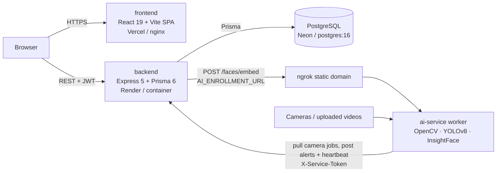

# WareTrace — Warehouse Traceability

End-to-end warehouse and yard traceability: rail and road receiving with bay allocation, bay and
material/lot mapping with QR codes, dispatch approval and gate validation, truck journey tracking
with RFID, SAP validation, role-based access, and AI camera surveillance (motion, person/wall
intrusion, man inside wagon, vehicle over-speed, cancelled vehicle, face registry).

The web app is branded **SAIL Yard** and has a redesigned light/dark interface (the theme toggle is
in the top bar and on the sign-in page; the choice is remembered per browser).

The full technical reference (architecture, API routes, data model, every environment variable,
deployment and security notes) is in **[docs/TECHNICAL.md](docs/TECHNICAL.md)**.

## Architecture



| Folder        | What it is                                                                          |
|---------------|-------------------------------------------------------------------------------------|
| `frontend/`   | React 19 + Vite 8 SPA (react-router, react-leaflet yard map, axios)                 |
| `backend/`    | Express 5 API, Prisma ORM (PostgreSQL, SQL migrations), JWT auth + RBAC, SAP connector (mock/HTTP), camera streaming |
| `ai-service/` | Python worker: YOLOv8 detectors, face registry, rule engine, alert reporting, face-enrollment API on :8600 |
| `docs/`       | Technical reference, phase documents and the SAP integration spec                  |

Roles: `ADMIN`, `SUPERVISOR`, `OPERATOR`, `MANAGER` (see `backend/src/config/roles.js`).

## Receiving & storage

One page, **Receiving & storage** (`/inbound`), takes material from arrival to a bay. It replaces the
old Bays & Layout, Materials and Bay Allocation pages (their URLs redirect).

- **Inbound queue** — lots moving from *awaiting arrival* → *pending allocation* → *allotted*, with
  Rail / Road filters, scan-to-place and direct placement.
- **In storage** — placed lots with move, remove, movement history and lot / bay QR codes.
- **Catalogue** — materials and their lots.
- **Layout** — bays, zones and loading docks, with a quick *Add bay* form.

**Receive material** is the only way to add stock. *Road* arrivals are entered in one step (material
and lot). *Rail* arrivals are picked from the pending FOIS / SAP consignment list and imported, so
nothing is re-typed. A ranked bay recommendation (a static placeholder until a demand model exists)
then helps a supervisor allot a bay, and an operator confirms the physical placement. Details:
[docs/INBOUND.md](docs/INBOUND.md) and [docs/BAY_ALLOCATION.md](docs/BAY_ALLOCATION.md).

The feature adds two migrations (`arrival_mode_bay_allocation`, `inbound_lot_source`); they apply
with `npm run migrate` (Docker and Render run them automatically).

## Quick start with Docker (recommended)

Requires Docker Desktop (or Docker Engine with Compose v2). Nothing else.

```bash
git clone https://github.com/dhanushkumarb01/warehourseTraceability.git
cd warehourseTraceability
cp .env.example .env
docker compose up --build
```

The first build takes several minutes (the AI image downloads PyTorch CPU wheels and the YOLOv8 and
InsightFace models). When all four containers report `healthy` (`docker compose ps`), create the
first admin and optional demo data in a second terminal:

```bash
docker compose run --rm backend npm run seed:admin    # uses BOOTSTRAP_ADMIN_* from .env
docker compose run --rm backend npm run seed:demo     # bays, materials, lots (optional)
docker compose run --rm backend npm run seed:trucks   # trucks and RFID readers (optional)
```

Open **http://localhost:8088** and sign in as `admin` / `admin123` (the `.env.example` defaults —
change them, and the generated secrets, before exposing the stack anywhere).

| Service     | URL (host)                         | Notes                                          |
|-------------|------------------------------------|------------------------------------------------|
| frontend    | http://localhost:8088              | nginx, SPA fallback to `index.html`            |
| backend     | http://localhost:5000/api          | health: http://localhost:5000/health           |
| ai-worker   | http://localhost:8600/health       | face-enrollment API (Flask development server) |
| db          | not published                      | `docker compose exec db psql -U waretrace warehouse_traceability` |

Host ports are set in `.env` (`FRONTEND_PORT`, `BACKEND_PORT`, `AI_WORKER_PORT`). If you change
`FRONTEND_PORT`, also change `FRONTEND_URL` (CORS); if you change `BACKEND_PORT`, also change
`VITE_API_BASE_URL` and rebuild the frontend (`docker compose up --build frontend`).

Migrations run automatically every time the backend container starts; seeding never does.
Data lives in named volumes (`db-data`, `backend-storage`, `ai-cache`, `ai-models`).
`docker compose down` keeps them; `docker compose down -v` deletes them (add `--rmi local` to also
remove the built images).

## Quick start without Docker

Prerequisites: **Node.js 20+**, **PostgreSQL** (tested with 16 and 17), and **Python 3.11** for the
AI worker (optional unless you use camera AI). No GPU is needed; inference runs on CPU.

```bash
# 1. Database
createdb -U postgres warehouse_traceability

# 2. Backend
cd backend
cp .env.example .env        # edit DATABASE_URL, JWT_SECRET, AI_SERVICE_TOKEN
npm install
npm run prisma:generate
npm run migrate             # prisma migrate deploy
npm run dev                 # http://localhost:5000

# 3. Frontend (new terminal)
cd frontend
cp .env.example .env        # VITE_API_BASE_URL=http://localhost:5000/api
npm install
npm run dev                 # http://localhost:5173

# 4. AI worker (optional, new terminal)
cd ai-service
python -m venv .venv
.venv\Scripts\activate      # Linux/macOS: source .venv/bin/activate
pip install -r requirements.txt
cp .env.example .env        # AI_SERVICE_TOKEN must equal the backend's
python main.py              # enrollment API on :8600
```

Natively, model weights download on the worker's first run (`yolov8n.pt` by ultralytics,
`buffalo_l` by InsightFace), so the first start needs internet access.

Create the first admin (the script reads credentials only from the environment and does nothing if
an `ADMIN` already exists):

```bash
cd backend
BOOTSTRAP_ADMIN_USERNAME=admin BOOTSTRAP_ADMIN_EMAIL=admin@example.com \
BOOTSTRAP_ADMIN_PASSWORD='<choose-a-password>' npm run seed:admin
npm run seed:demo && npm run seed:trucks    # optional demo data
```

```powershell
# PowerShell
$env:BOOTSTRAP_ADMIN_USERNAME='admin'; $env:BOOTSTRAP_ADMIN_EMAIL='admin@example.com'
$env:BOOTSTRAP_ADMIN_PASSWORD='<choose-a-password>'; npm run seed:admin
```

Sign in with the username **or** the email.

## Configuration

Real `.env` files are git-ignored; every one has a documented `.env.example`.

| Used by          | File                       | Must set                                                                 |
|------------------|----------------------------|--------------------------------------------------------------------------|
| Docker Compose   | `.env.example` (root)      | Defaults work locally. `NGROK_AUTHTOKEN` only for the tunnel profile     |
| backend          | `backend/.env.example`     | `DATABASE_URL`, `FRONTEND_URL` (CORS allow-list), `JWT_SECRET`; `AI_SERVICE_TOKEN` for the AI worker |
| frontend         | `frontend/.env.example`    | `VITE_API_BASE_URL` (must end in `/api`; baked in at build time)         |
| ai-service       | `ai-service/.env.example`  | `AI_SERVICE_TOKEN` (same value as the backend), `WARETRACE_API_URL`      |

Generate secrets with `openssl rand -hex 32`. SAP runs in `SAP_MODE=mock` by default; see
`docs/SAP_INTEGRATION_SPEC.md` for a real gateway. The full variable reference is in
[docs/TECHNICAL.md](docs/TECHNICAL.md#environment-variables).

## AI worker and ngrok

The worker **pulls** camera jobs from the backend and posts alerts and heartbeats back, so it only
needs outbound access. The one inbound call is face enrollment: the backend posts registration
images to the worker's `POST /faces/embed` at `AI_ENROLLMENT_URL`. Locally (Docker or native) that
is `http://ai-worker:8600` / `http://localhost:8600`. When the backend runs in the cloud, the worker
is exposed through an **ngrok static domain** so the URL never changes:

```text
AI_ENROLLMENT_URL=https://alexia-intertribal-nonsubtractively.ngrok-free.dev
```

`/faces/embed` requires the `X-Service-Token` header (401 without it). `/health` returns only
`{"ok": true, "faceModelAvailable": true}`. Opened in a browser, the free ngrok domain first shows
ngrok's warning page; server-to-server calls (the backend) are not affected.

**Native (Windows), serving the deployed backend** — install ngrok 3, run
`ngrok config add-authtoken <token>` once, put the backend's `AI_SERVICE_TOKEN` in
`ai-service/.env`, then:

```powershell
powershell -ExecutionPolicy Bypass -File ai-service\start-demo.ps1
```

It wakes the Render backend, starts `python main.py`, runs
`ngrok http --url=https://alexia-intertribal-nonsubtractively.ngrok-free.dev 8600`, waits until
`/health` answers through the tunnel and prints the URL. Ctrl+C stops both.

**Docker, with the tunnel** — set `NGROK_AUTHTOKEN` (and `NGROK_DOMAIN`) in `.env`, then
`docker compose --profile tunnel up --build`. To point the same worker image at the cloud backend
instead of the local one, set `WARETRACE_API_URL=https://warehouse-traceability-api.onrender.com`
and that backend's `AI_SERVICE_TOKEN` in `.env`, and start only the worker and tunnel:

```bash
docker compose --profile tunnel up --build --no-deps ai-worker ngrok
```

A free ngrok domain allows one agent session at a time: stop the native script before starting the
Docker tunnel and vice versa.

## Live deployment

| Part      | Where                                                         | Deploys                                    |
|-----------|---------------------------------------------------------------|--------------------------------------------|
| frontend  | Vercel, https://warehouse-traceability.vercel.app (root `frontend/`) | automatically on push to `main`      |
| backend   | Render free web service, https://warehouse-traceability-api.onrender.com (root `backend/`) | **manually** (dashboard or Render API) |
| database  | Neon PostgreSQL (pooled connection)                            | migrations run in Render's build command (`PRISMA_SCHEMA_DISABLE_ADVISORY_LOCK=1`) |
| AI worker | a local machine running `ai-service/start-demo.ps1`, reachable via the ngrok domain | by hand            |

Render's free tier sleeps when idle (the first request takes 30–60 s) and its disk is ephemeral:
uploaded videos and alert snapshots disappear on every deploy or restart. See
[docs/TECHNICAL.md](docs/TECHNICAL.md#deployment) for details.

## Quality checks

```bash
cd backend && npm test             # unit tests; integration suite skipped without TEST_DATABASE_URL
TEST_DATABASE_URL=postgresql://... npm run test:integration   # disposable, fully migrated DB only
cd frontend && npm run lint && npm run build
docker compose config --quiet      # validates docker-compose.yml + .env
```

## Troubleshooting

- **`[CONFIG] Required environment variable ... is not set`** — create `backend/.env` from the example
  (Docker: `JWT_SECRET` / `AI_SERVICE_TOKEN` missing in the root `.env`).
- **CORS errors in the browser** — add the exact frontend origin to `FRONTEND_URL` (comma-separated;
  trailing slashes are ignored) and restart the backend.
- **`Bind for 0.0.0.0:8088 failed: port is already allocated`** — change `FRONTEND_PORT` (and
  `FRONTEND_URL`) in `.env`. Same for 5000 / 8600.
- **`Port 5173 is in use`** (native) — Vite moves to the next free port. 5173 and 5174 are in the
  backend's default CORS list; for any other port, add its origin to `FRONTEND_URL`.
- **AI worker "Aborting" at start** — `AI_SERVICE_TOKEN` is empty.
- **AI status OFFLINE** — no heartbeat for 30 s: the worker is stopped, points at another backend, or
  its token does not match (401s in its log).
- **Face enrollment returns 503 "service is unavailable"** — the backend cannot reach
  `AI_ENROLLMENT_URL`; check the worker and the tunnel (`curl https://<domain>/health`).
- **`ngrok` error `ERR_NGROK_334` / endpoint already online** — another ngrok session already holds
  the static domain; stop it first.
- **`exec ./docker-entrypoint.sh: no such file or directory`** — the script has CRLF line endings
  (a clone made before `.gitattributes` forced LF, or an editor converted it). Save it with LF
  endings, or re-clone, and rebuild.

More in [docs/TECHNICAL.md](docs/TECHNICAL.md#troubleshooting).

## Documentation

- [docs/TECHNICAL.md](docs/TECHNICAL.md) — complete technical reference
- [docs/INBOUND.md](docs/INBOUND.md) — the Receiving & storage page and the FOIS / SAP rail import
- [docs/BAY_ALLOCATION.md](docs/BAY_ALLOCATION.md) — arrival mode, layout coordinates, bay recommendation and allocation
- [ai-service/README.md](ai-service/README.md) — AI worker internals
- `docs/PHASE5_MATERIAL_BAY_MAPPING.md`, `docs/PHASE6_DISPATCH_GATE.md`, `docs/PHASE7_AUTH_RBAC.md`,
  `docs/SAP_INTEGRATION_SPEC.md` — phase design documents
